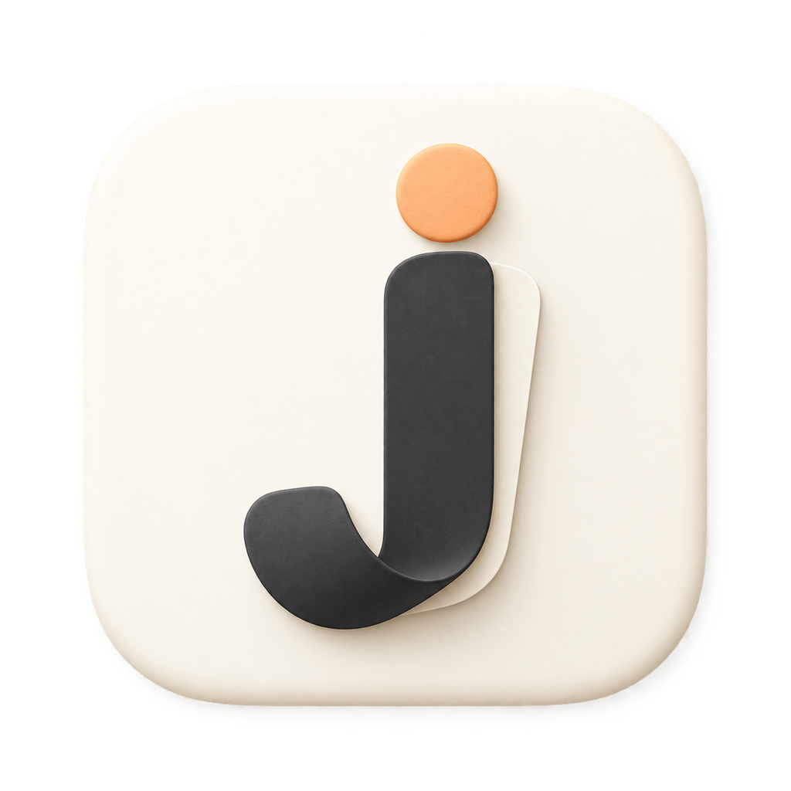
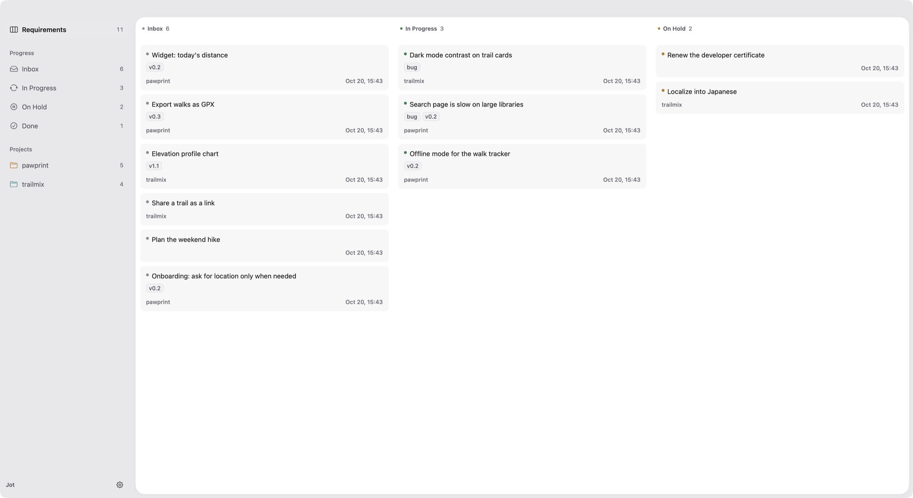

<p align="center">
  
</p>

<h1 align="center">Jot</h1>

<p align="center"><strong>A local requirements board for one person and their AI agents: capture from the terminal or a chat, track progress on a native macOS board.</strong></p>

<p align="center">
  <a href="https://github.com/RedHiwiK/jot/actions/workflows/ci.yml"></a>
  <a href="https://github.com/RedHiwiK/jot/releases/latest"></a>
  
  
  
  <a href="LICENSE"></a>
</p>

<p align="center">
  <a href="#install">Install</a> · <a href="https://kunkunred.hiwik.cn/en/projects/jot/docs/">Documentation</a> · <a href="docs/en/guides/ai-agents.md">Use with AI agents</a> · <a href="docs/en/reference/cli.md">CLI reference</a> · <a href="README.zh-CN.md">简体中文</a>
</p>

Jot keeps the requirements, ideas and to-dos that come up while you work: "the search page is slow", "add GPX export in v0.2", "renew the certificate". You (or your coding agent) capture one with a single command; Jot files it under the Git repository you are in, and you move it from Inbox to In Progress to Done on a board.

It is a `jot` CLI with JSON output, a native SwiftUI app and a skill file for Claude Code, Codex and other agents, all sharing one local store: SQLite for metadata, one Markdown file per requirement for the body. No account, no server, no sync service.



## Install

**Let your agent do it.** Paste this into Claude Code, Codex or any coding agent:

```text
Install the jot CLI and its skill by following https://github.com/RedHiwiK/jot/blob/main/docs/en/guides/ai-agents.md
```

**macOS app** (includes the CLI):

```bash
curl -fsSLO https://github.com/RedHiwiK/jot/releases/latest/download/Jot_macos.zip
ditto -x -k Jot_macos.zip /Applications
xattr -dr com.apple.quarantine /Applications/Jot.app      # ad-hoc signed, not notarized
mkdir -p ~/.local/bin && ln -sf /Applications/Jot.app/Contents/Helpers/jot ~/.local/bin/jot
```

**CLI only** (macOS or Linux):

```bash
go install github.com/RedHiwiK/jot/cmd/jot@latest
```

or download `jot_<os>_<arch>.tar.gz` from [Releases](https://github.com/RedHiwiK/jot/releases/latest). macOS ships an unrelated `/usr/bin/jot`: put `~/.local/bin` (or your Go bin directory) before `/usr/bin` in `PATH`, and check that `jot --version` prints `jot version 0.1.0`.

## Quick start

```bash
jot init                                             # creates ~/.jot
cd ~/code/myapp                                      # any Git repository
jot add "Search page is slow" --note "Traced to a DB query in onChange" --tag v0.2
jot add "Renew the developer certificate" --unfiled  # personal, no project
jot ls                                               # active requirements by state
jot mv 1 in_progress
jot mv 1 done
jot ls --tag v0.2 --all --json                       # everything for a release, as JSON
```

The first capture inside a repository registers it as a project automatically. Projects are optional; tags such as `v0.2` or `bug` cut across them.

## Use it from your AI agent

Install the skill (Claude Code shown; Codex uses `~/.codex/skills`):

```bash
mkdir -p ~/.claude/skills/jot
curl -fsSL https://raw.githubusercontent.com/RedHiwiK/jot/main/skills/jot/SKILL.md -o ~/.claude/skills/jot/SKILL.md
```

Then talk normally:

- "Note this down: the export button is hidden on small windows." → `jot add ...`, and the agent goes back to what it was doing.
- "What's on my plate for myapp?" → `jot ls --project myapp --json`, summarized.
- "Clean up the inbox and tag the release items v0.2." → `jot triage`, `jot tag`.
- "Mark 42 done." → `jot mv 42 done`.
- After opening a PR for requirement 42, the agent runs `jot link 42 <url>` and writes `JOT-42` in the PR.

The skill only manages requirements; it never starts implementing one on its own. Details: [AI agents](docs/en/guides/ai-agents.md).

## Features

- **Capture in one line** from the terminal, a script (`--stdin`) or an agent; the project is inferred from the current Git repository, including worktrees.
- **Five states** that record intent, not process status: `inbox`, `in_progress`, `on_hold`, `done`, `archived`. Every transition is logged.
- **Projects and tags**: at most one project per requirement, any number of free-form tags (versions, themes), filters with AND/OR.
- **Plain files**: each body is a Markdown file you can open in any editor; frontmatter mirrors the metadata.
- **PR/MR links** bound to requirements and shown in the app.
- **Native macOS app**: board with drag and drop, Markdown detail and editing, global search, English and Chinese, light and dark themes, customizable shortcuts.
- **Agent-ready**: `--json` on every command, batch results with per-item failures, an included skill, `JOT_HOME` for isolated stores.

## How it works

```
   you in a terminal        Claude Code / Codex / Cursor          Jot.app (SwiftUI)
          |                   (skills/jot/SKILL.md)                       |
          |                             |                                 | runs the bundled CLI,
          v                             v                                 | decodes its JSON
  +------------------------------------------------------------------------------+
  |  jot CLI (Go, single static binary)                                          |
  |  state rules · project inference · tag normalization · frontmatter sync      |
  +------------------------------------------------------------------------------+
          |                                              |
          v                                              v
  ~/.jot/jot.db  (SQLite, WAL)                 ~/.jot/reqs/<project>/0042-...md
  metadata, state history, tags, links         requirement bodies (Markdown)
```

The app never touches the database directly, so every rule lives in one place: the CLI. See [Files and data](docs/en/reference/data-model.md).

## Documentation

The full documentation, in English and Chinese, with search: **[kunkunred.hiwik.cn/en/projects/jot/docs](https://kunkunred.hiwik.cn/en/projects/jot/docs/)**. The same pages live in [`docs/`](docs/) and read fine on GitHub.

| Section | Pages |
|---|---|
| Getting started | [Introduction](docs/en/getting-started/introduction.md) · [Installation](docs/en/getting-started/installation.md) · [Quick start](docs/en/getting-started/quick-start.md) |
| Guides | [Capturing](docs/en/guides/capturing.md) · [Projects and tags](docs/en/guides/projects-and-tags.md) · [Workflow](docs/en/guides/workflow.md) · [The macOS app](docs/en/guides/macos-app.md) · [AI agents](docs/en/guides/ai-agents.md) · [Pull requests](docs/en/guides/pull-requests.md) |
| Reference | [CLI](docs/en/reference/cli.md) · [JSON output](docs/en/reference/json-output.md) · [Files and data](docs/en/reference/data-model.md) · [Configuration](docs/en/reference/configuration.md) |
| Help | [Troubleshooting](docs/en/help/troubleshooting.md) · [Changelog](CHANGELOG.md) |

For agents, the whole documentation as one file: [llms-full.txt](https://kunkunred.hiwik.cn/en/projects/jot/llms-full.txt).

## For AI agents

- Working **with** Jot (capturing and organizing requirements for a user): read [AI agents](docs/en/guides/ai-agents.md) and [skills/jot/SKILL.md](skills/jot/SKILL.md). Prefer `--json`, check exit codes, and never run `jot purge` unless the user explicitly asks.
- Working **on** this repository: read [AGENTS.md](AGENTS.md) for the repository map, build and test commands and conventions.

## Build from source

Requires Go 1.27+, Swift 6 and macOS 14+ (the CLI alone builds anywhere Go runs).

```bash
make test          # go vet, go test, swift test
make install       # CLI to ~/.local/bin/jot
make install-app   # macos/build/Jot.app to /Applications
make dist          # release archives in dist/
```

Contributions are welcome; see [CONTRIBUTING.md](CONTRIBUTING.md).

## License

MIT. See [LICENSE](LICENSE).
